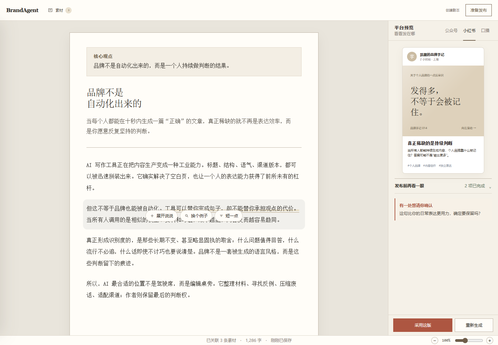

<div align="center">

# BrandAgent

**面向个人创作者的品牌写作工作台**

素材 → 核心观点 → 稿纸 → 平台预览，一次写完，处处像你。

[](https://nextjs.org)
[](https://www.typescriptlang.org)
[](https://www.python.org)
[](https://github.com/langchain-ai/langgraph)
[](https://fastapi.tiangolo.com)
[](https://www.postgresql.org)
[](https://modelcontextprotocol.io)
[](./LICENSE)

[特性](#-特性) · [快速开始](#-快速开始) · [工作方式](#-工作方式) · [架构](#-架构) · [路线图](#%EF%B8%8F-路线图) · [参与贡献](#-参与贡献)

</div>

---

## 为什么是 BrandAgent

把一句想法写成公众号、小红书、口播稿，难的不是"生成文字"——是**每一句都还得像你自己**，还得**站得住**：

- AI 写得越流利，越容易塞进你没说过的数字和事实
- 一个观点改写三次后，"你的语气"就没了
- 换平台重排一遍，三次复制粘贴，三次走样

BrandAgent 的答案不是更强的模型，而是**把品牌资产工程化**：

```
你的素材（录音稿 / 笔记 / 文章）
   ↓ 蒸馏成可溯源的引用摘录
核心观点（一句话，全文围绕它）
   ↓
稿纸（720px，自由写作，选中即改写）
   ↓ 采用
平台预览（公众号 / 小红书 / 60 秒口播）
```

每一条 AI 建议只能引用**你关联过的素材**；每一个数字断言都要在素材里**找得到原文**；每一次平台改写都**绑定母稿快照**——改坏了随时回到上一版。



> 素材抽屉（默认收起）· 核心观点卡片 · 720px 稿纸 · 平台预览（右侧 80% 缩放）

## ✨ 特性

**素材可信** —— 粘贴文本/笔记一键导入，自动分块蒸馏为可引用摘录；每条摘录带 provenance hash，可回溯到原文位置。素材是**候选材料**，不是"已验证事实"——AI 想引用，先过溯源这一关。

**选区改写** —— 在稿纸上选中一句话，点「展开说说 / 换个例子 / 短一点」。建议锚定 block id + 字符偏移 + 文本 hash 三重校验；你改了稿，旧建议自动失效（409），**永远不会有 AI 覆盖你新输入的瞬间**。

**平台预览** —— 公众号是浅底黑字的文章结构，小红书是带标签的卡片，口播是逐行脚本——三套真实结构，不是同一段文字换壳。预览免审批，随时可看；重新生成只新增版本，不碰母稿。

**发布前再看一眼** —— 采用母稿时自动跑确定性检查：数字断言是否可溯源、表达是否离你的口吻太远。提示是口语（"这句比你的日常表达更用力，确定要保留吗？"），没有技术黑话。

**自动保存，断线不丢稿** —— 800ms 防抖保存 + revision 乐观并发（409 不覆盖服务器稿）+ sessionStorage 备份恢复 + `beforeunload` keepalive。六种真实状态：loading / saved / dirty / saving / conflict / error。

**配额透明** —— FastAPI usage ledger 唯一权威：reserve → settle/refund 幂等结算，真实 token 优先、预估兜底。额度耗尽只停 AI 功能，**写作和保存永远不受影响**。

**企业级底座（BrandFlow）** —— 同一个后端内核：不可变内容版本、血缘追踪（这句话来自哪条素材、哪个母稿版本）、审计事件流、MCP 高风险工具门禁。个人版用不到，但它们一直在你脚下。

## 🚀 快速开始

> 前置：Node 18+ / Python 3.11+ / PostgreSQL 16（或用 Docker Compose 一键拉起）。AI 能力需要[智谱 API Key](https://open.bigmodel.cn/)，登录需要 [Clerk](https://clerk.com/) 账号。

```bash
# 1. 克隆
git clone https://github.com/kayon0209/brandagent.git
cd brandagent

# 2. 环境变量
cp .env.example .env.local          # 填 Clerk / GLM / 数据库凭证

# 3. 一键启动（PostgreSQL + MCP + Agent API + Web）
docker compose up --build

#    或本地分步启动：
#    PostgreSQL → services/brand-tools-mcp → services/agent-api → npm run dev
```

打开 `http://localhost:3000/app`，登录后：导入一段素材 → 写下核心观点 → 生成初稿 → 选中一句话试试改写。

<details>
<summary><b>本地开发（不用 Docker）</b></summary>

```bash
# 数据库迁移（只增不删，详见 docs/migrations/）
psql -f docs/migrations/001_init.sql
psql -f docs/migrations/002_brandflow_v2_foundation.sql
psql -f docs/migrations/003_consumer_experience.sql
psql -f docs/migrations/004_consumer_rls.sql

# MCP 服务
cd services/brand-tools-mcp && pip install -e . && python -m brand_tools_mcp.server

# Agent API
cd services/agent-api && pip install -e . && uvicorn agent_api.api.bootstrap:app

# Web
corepack pnpm install
npm run dev
```

</details>

<details>
<summary><b>质量命令（提交前全绿）</b></summary>

```bash
npm run lint              # ESLint
npm run typecheck         # tsc --noEmit
npm run test:contracts    # 契约测试（OpenAPI ↔ TS ↔ Python 三方一致）
npm run test:unit         # Jest 单元 + 组件测试
npm run test:e2e          # Playwright（需 BRANDFLOW_E2E_STORAGE_STATE）

# Python 侧
services/agent-api/.venv/Scripts/python -m pytest services/agent-api/tests -q
services/agent-api/.venv/Scripts/python -m pytest services/brand-tools-mcp/tests -q
```

</details>

## 🧱 工作方式

一条数据的旅程：

```
导入："我们这期播客聊了 3 个误区，第一个是……"
   ↓ SimpleTextParser 分块 + HeuristicDistiller 蒸馏
摘录卡片：「误区一：把日更当成坚持」(quote · #日更 #误区)
   ↓ 关联到项目
稿纸写作：「大多数人卡在第一步——把日更当成坚持」
   ↓ 选中「把日更当成坚持」→ 换个例子
AI 建议：只看选区 + 上下文句 + 核心观点 + 已关联摘录
   ↓ （建议里的数字若不在素材里 → 拒绝生成）
采用 → 不可变母稿快照 + 确定性检查
   ↓
公众号 / 小红书 / 口播（每个版本绑定母稿 hash + lineage）
```

三条设计红线，写进了测试：

1. **AI 失败绝不改稿** —— 选区建议崩溃/超时/格式错，你的稿一个字不动
2. **预览 ≠ 发布** —— 平台预览零门槛；真正导出/发布走 MCP 高风险工具门禁，fail-closed
3. **跨租户 404** —— 任何 workspace 边界外的 id 一律 404，不泄露存在性

## 🏗️ 架构

```
┌─────────────────────────────────────────────────────┐
│  Next.js 15.5 (src/app/(consumer)/app)              │
│  稿纸 · Tiptap 选区锚定 · SSE 状态流                 │
└───────────────┬─────────────────────────────────────┘
                │ 同源 BFF（/api/brandagent，注入 Clerk token）
┌───────────────▼─────────────────────────────────────┐
│  FastAPI agent-api (/api/v1/consumer)               │
│  projects · drafts · suggestions · variants · usage │
├─────────────────────────────────────────────────────┤
│  LangGraph 长任务（首稿生成：无审批 interrupt）        │
│  确定性 review · 不可变 content_versions             │
├─────────────────────────────────────────────────────┤
│  brand-tools-mcp（九项品牌工具 + 高风险审批门禁）      │
├─────────────────────────────────────────────────────┤
│  PostgreSQL（RLS 租户隔离 · usage_ledger · lineage） │
└─────────────────────────────────────────────────────┘
```

- **契约先行**：[brandflow-openapi.yaml](./docs/brandflow-openapi.yaml) 是唯一权威，TS 类型由 `npm run generate:types` 生成，Python 模型与其对齐——三方漂移会被契约测试当场拦下
- **租户隔离**：每个请求带 workspace 边界 + RLS（004 migration）+ `set_config('app.workspace_id')` 三层
- **幂等内建**：写命令全部要求 Idempotency-Key；usage ledger 对 `(workspace, request_id)` 唯一，重复 settle 不重复计费

<details>
<summary><b>目录速览</b></summary>

```
src/
  app/(consumer)/app/     # C 端路由组：项目列表 / 素材库 / write/[projectId]
  app/brandflow/          # 企业版工作台（兼容窗口保留）
  components/consumer/    # editor / materials / preview / layout
  hooks/                  # useConsumerDraft（自动保存状态机）等
  lib/api/                # BFF 客户端（全部走 /api/brandagent）
services/
  agent-api/              # FastAPI + LangGraph（src/agent_api/）
  brand-tools-mcp/        # 独立 MCP server
docs/
  migrations/             # 只前进的编号迁移
  MASTER_PLAN.md          # 阶段与门禁权威索引
  brandflow-openapi.yaml  # API 契约（权威）
```

</details>

## 🗺️ 路线图

- [x] Phase 0 — 规格、工具链与契约基线
- [x] Phase 1 — 真实身份与个人 workspace
- [x] Phase 2 — 素材闭环（导入 → 蒸馏 → 溯源 → 关联）
- [x] Phase 3 — 稿纸、自动保存与选区改写
- [x] Phase 4 — 平台预览与发布前检查
- [x] Phase 5 — 配额账本、golden 评测、完整旅程
- [ ] Phase 6 — 深度调研（受限多 Agent 取证，先跑 S0/S1/S2 对照实验）

详细门禁见 [MASTER_PLAN](./docs/MASTER_PLAN.md)。

## 📚 更多文档

| 文档 | 内容 |
|---|---|
| [MASTER_PLAN](./docs/MASTER_PLAN.md) | 阶段、门禁、Golden Gate 阈值 |
| [PRD v2](./docs/PRD-v2.md) | 产品需求与用户旅程 |
| [升级计划全文](./docs/superpowers/plans/2026-08-28-consumer-brandagent-upgrade.md) | 架构权威规格（第 1–9 节） |
| [部署 Runbook](./docs/deployment/RUNBOOK.md) | 启动、恢复、回滚、密钥轮换 |
| [API 契约](./docs/brandflow-openapi.yaml) | OpenAPI 3.1，类型生成源 |

## 🤝 参与贡献

1. Fork → 新分支（`feat/xxx`）
2. 改动前先看 [AGENTS.md](./AGENTS.md)（目录结构、命名、迁移规则）
3. 红线：数据库迁移只增不删；prompt 改动先过 `_sandbox/` 测试；API Route 不超 50 行业务逻辑
4. 提交前全绿：`lint + typecheck + test:contracts + test:unit`（Python 侧 `pytest` 两套）
5. PR 描述里附质量命令的真实输出

## 前身项目

BrandAgent 由 **AI Blog Assistant**（中文博客 AI 写作助手：结构化扩写、标题/大纲生成、三级润色、SEO 分析）演进而来，后端沉淀为 BrandFlow 企业内容工作流，再于 2026-08 升级为面向个人创作者的写作工作台。旧版页面在兼容窗口内保留（`/dashboard`），不承载新功能。完整演进史见 [PRD v2](./docs/PRD-v2.md)。

## License

[MIT](./LICENSE)

---

<div align="center">

**BrandAgent** · 写作是你，发布也像你。

</div>
