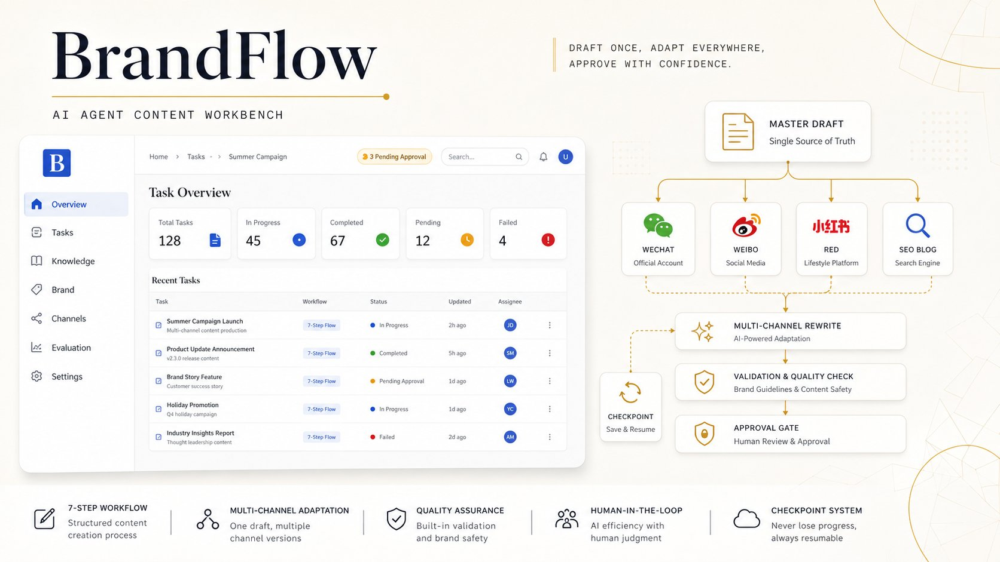
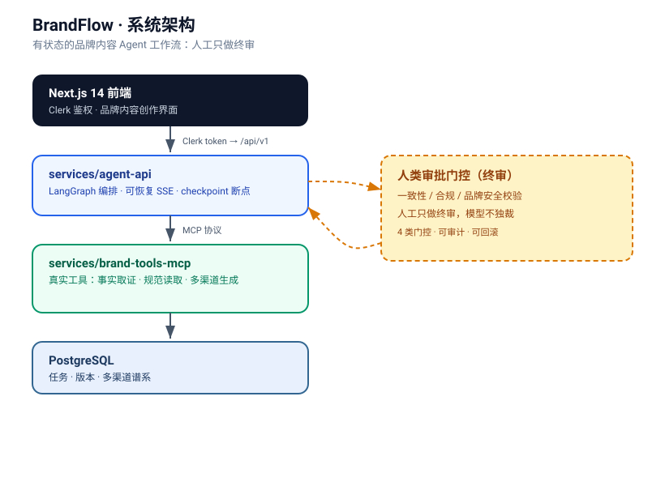

# BrandFlow · 品牌内容智能体工作台（BrandAgent）

> 把"写文章"变成一条**可追溯、可审批、可复用规范、可跨渠道一致**的品牌内容生产工作流——而不是又一个聊天机器人。

[](https://nextjs.org)
[](https://www.typescriptlang.org)
[](https://github.com/langchain-ai/langgraph)
[](https://modelcontextprotocol.io)
[](./LICENSE)



## 为什么是 BrandFlow，而不是「另一个 AI 写作助手」

把一句话主题变成一篇完整博客，前身 AI Blog Assistant 已经能做到。但品牌内容生产的**核心矛盾不是"生成文字"**，而是：产出要可追溯、关键节点要有人审、品牌规范要能复用迭代、同一份内容要能跨渠道保持一致。

BrandFlow 把写作助手沉淀为一套**有状态的 Agent 工作流**：需求先收敛成结构化 Brief，事实先取证再落笔，规范版本化管理，关键节点必须人工终审，产出带多渠道谱系。模型是执行单元，不是主界面。

## 核心能力

- **结构化 Brief** —— 把零散需求收敛为可执行的品牌内容任务书
- **权威事实取证** —— 引用可溯源，拒绝编造
- **版本化品牌 / 渠道规范** —— 规范可迭代、可回滚
- **人类审批闭环** —— 关键节点必须人审，模型不独裁；终审门控含一致性 / 合规 / 品牌安全等校验
- **多渠道谱系** —— 一次创作，多平台内容可追溯同源
- **可恢复的有状态流程** —— 基于 LangGraph 的检查点（checkpoint），任务中断可从断点恢复，不丢进度
- **真实 MCP 工具调用** —— 通过 MCP 协议调用真实业务工具（事实取证 / 规范读取 / 多渠道生成），而非假装

## 系统架构



```
Next.js 14（前端 / Clerk 鉴权）
   │  Clerk token → /api/v1
   ▼
services/agent-api      （Python · LangGraph 编排 · 可恢复 SSE）
   │  MCP
   ▼
services/brand-tools-mcp（真实工具：事实取证 / 规范读取 / 多渠道生成）
   │
   ▼
PostgreSQL             （任务 / 版本 / 谱系）
```

**任务流（人工只做终审）**：主稿定稿 → 4 渠道改写 → 校验 → 终审门控。每一环都是可恢复的有状态节点，checkpoint 断点 + 版本血缘 + 幂等 + 四类终审门控共同保证**可审计、可回滚**。

## 快速启动

> 前置：本地 PostgreSQL（或 `docker compose`）、Node 18+、Python 3.11+。

```bash
# 1. 配置环境变量（密钥不提交）
cp .env.example .env.local        # 填写数据库 / Clerk / GLM / 内部 MCP 服务凭证
cp services/agent-api/.env.example services/agent-api/.env

# 2. 启动（方式 A：本地分别启动）
#    PostgreSQL → services/brand-tools-mcp → services/agent-api → Next.js
#    或（方式 B）一条命令拉起全部：
docker compose up --build

# 3. 访问
#    前端：http://localhost:3000/brandflow
#    Web 通过 Clerk token 调用 /api/v1，任务更新使用可恢复 SSE
```

```bash
# 后端测试（agent-api + brand-tools-mcp）
cd services/agent-api && python -m pytest -p no:cacheprovider services/agent-api/tests services/brand-tools-mcp/tests

# 前端 lint & build
npm run lint
npm run build
```

部署、恢复、密钥轮换与故障处理见 [`docs/deployment/RUNBOOK.md`](./docs/deployment/RUNBOOK.md)；产品与里程碑状态见 [`docs/PRD-v2.md`](./docs/PRD-v2.md)。

## 技术栈

| 分类 | 技术 |
|------|------|
| 前端框架 | Next.js 14 App Router |
| 样式 | TailwindCSS + CSS Variables |
| 身份认证 | Clerk v6 |
| 后端编排 | Python · LangGraph（可恢复流程） |
| 工具协议 | MCP（brand-tools-mcp） |
| 数据库 | PostgreSQL |
| AI 模型 | 智谱 GLM (glm-4.5-air) |
| 部署 | Docker / Vercel |
| 语言 | TypeScript 5 · Python |

## 文档

- [PRD v2（双引擎：写作助手 + BrandFlow）](./docs/PRD-v2.md)
- [部署 Runbook](./docs/deployment/RUNBOOK.md)
- [项目开发规范](./CLAUDE.md)

## 前身项目：AI Blog Assistant（旧版）

> BrandFlow 由 **AI Blog Assistant**（一个面向中文博客的 AI 写作助手：结构化扩写、标题 / 大纲生成、三级润色、SEO 分析与 Token 级配额）重构演进而来。旧版的完整功能、架构与本地运行说明见 [PRD v2](./docs/PRD-v2.md)；新功能开发请以 BrandFlow 为准。

## License

[MIT](./LICENSE) —— 详见 [LICENSE](./LICENSE) 文件。
